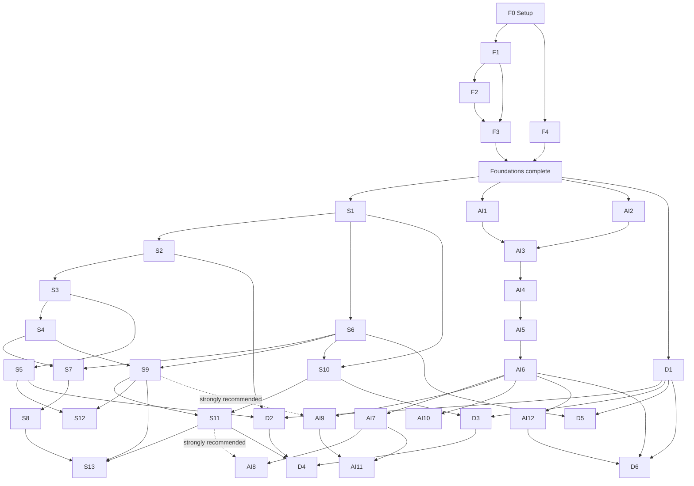

# Zero to Professional: Foundations → Systems, AI, or Security

This is a build-first curriculum. Start with Foundations. Then make **one** of Systems Engineering, AI & Machine Learning, or Security Engineering your main track. Add another track only after you meet its stated prerequisites.

For every course: **read → explain → solve → build → measure/test → write a retrospective**. A course is complete only when its required artifact is committed and you can explain its important decisions without notes.

## How to use this repository

1. Complete the Foundation Setup checklist, then `F1` → `F2` → `F3`; `F4` may run alongside `F3`. All four Foundation courses must be complete before a specialization begins.
2. Set up Linux before `S1`. Later Systems labs use Linux-specific APIs and tools; macOS alone is not an equivalent substitute. A VM, a Linux machine, or a development container is fine.
3. Create matching course folders with `./scripts/new-course-workspace <track> <course-slug>` before starting a course. The script copies the tracked lab, exercise, resource-log, and retrospective templates. Put substantial portfolio work in `projects/`.
4. Do not advance because you finished a reading. Advance only after meeting the course exit check.
5. Keep datasets, model weights, credentials, third-party course files, and personal information out of Git.



Solid arrows are required prerequisites; dashed arrows are strongly recommended preparation. The graph deliberately leaves independent courses side-by-side: for example, `S6` begins after `S1`, not after `S5`, and `AI10`/`AI12` may run beside `AI7` after `AI6`.

The systems-first path is recommended for completing every track. An AI-first learner starts `AI1` and `AI2` after completing Foundations, but should finish `S9` before `AI9` and `S11` before `AI8`. Security starts with `D1` after Foundations; its later courses wait for the specific systems or AI knowledge they need.

## Reading and access legend

Every local-book chapter/section below is required. The PDF page number can differ from the printed page, so the chapter/section identifier is authoritative.

| Code | Local book in `books/` |
| --- | --- |
| B1 | *But How Do It Know?* — J. Clark Scott |
| B2 | *The C Programming Language*, 2nd edition — Kernighan and Ritchie |
| B3 | *Digital Design and Computer Architecture* — Harris and Harris |
| B4 | *Operating Systems: Three Easy Pieces* (OSTEP) — Arpaci-Dusseau and Arpaci-Dusseau |
| B5 | *The Linux Programming Interface* (TLPI) — Michael Kerrisk |
| B6 | *What Every Programmer Should Know About Memory* — Ulrich Drepper |

- `🌐 Online/download`: a legal resource not stored here. Read it on its official site or download your own copy.
- `🛒 Obtain`: a book or material not stored here; borrow, buy, or acquire a legal personal copy.
- `🔐 Account/hardware`: an account, isolated training environment, Linux machine, or GPU is needed.

The PDFs are excluded from Git so this repository does not redistribute personal/copyrighted copies. See [books/README.md](books/README.md) for their index and [resources/README.md](resources/README.md) for every material that must be acquired.

## Repository layout

```text
books/                          personal PDF library; tracked reading map only
tracks/                         indexes for the four curriculum tracks
labs/<track>/<course>/           reproducible experiments and implementation notes
exercises/<track>/<course>/      drills, written answers, and tests
projects/<track>/<project>/      portfolio-quality projects and capstones
notes/<track>/<course>/          concept notes, resource logs, and retrospectives
resources/                       acquisition and environment checklist
templates/course-workspace/     starter files copied for each course
scripts/new-course-workspace    creates a per-course workspace from templates
```

Each non-trivial lab or project must have a `README.md` that states: goal, prerequisites, setup, commands to run, tests/measurements, result, and next improvement. The workspace script creates the course-level starter files; name individual labs predictably, for example `labs/02-systems-engineering/S4-cpu-caches/01-cache-simulator/`.

## External materials: important gap report

The local library covers much of Foundations and Systems, but **does not contain dedicated AI or security books**. Do not assume a systems PDF substitutes for ML, cryptography, or ethical-security training.

| Courses | Material that must be acquired separately | Access |
| --- | --- | --- |
| F1–F4 | Python tutorial, CS50x, DS&A practice source, *Mathematics for Machine Learning* | 🌐 |
| S6–S9 | Rust Atomics and Locks, Linux/manual pages, `perf` and tracing docs | 🌐 |
| S11–S12 | *Designing Data-Intensive Applications*, MIT 6.5840, *Database Internals* | 🛒/🌐 |
| S13 | accelerator and inference-server documentation | 🌐; 🔐 GPU preferred |
| AI1–AI12 | data/ML/deep-learning/LLM/MLOps/safety materials | 🌐; 🔐 GPU useful from AI4 |
| D1–D6 | threat modeling, cryptography, OWASP, pwn.college, PortSwigger, legal lab platform | 🛒/🌐; 🔐 isolated lab |

At 12–15 focused hours per week, plan about 3–4 months for Foundations, 10–13 months for Systems, 9–12 months for AI, and 5–7 months for Security. The complete path is normally 2.5–3.5 years part time.

# Track 1 — Foundations

## F0 — Foundation Setup

**Prerequisites:** none · **Time:** 1–2 days

**Set up:** a code editor, Git, Python, a terminal, a Git identity, and a private backup/remote. Create and run a Python “hello” script, initialise a scratch repository, make one commit, and record your operating system and tool versions in `notes/01-foundations/F0-foundation-setup/resources.md`.

**Read:** no book required. Use the official installation guides for your operating system, Python, Git, and editor. Linux is required before `S1`, not before F1.

**Exit check:** you can open a terminal, create/edit/run a file, inspect Git status, make a commit, and restore a previous file version.

## F1 — Computing and Programming Foundations (Python)

**Prerequisites:** F0 · **Time:** 4 weeks

**Learn:** computer components, binary, Python values/control flow/functions, files, exceptions, and terminal basics.

**Read:** `B1`, from **“Just the Facts Ma’am” through “The Magic Bus”**. B1 is organized by named sections rather than numbered chapters; this complete named span is required. Use 🌐 the Python tutorial and CS50x Weeks 0 and 6.

**Do:** 12 small Python programs; binary-encoding drills; a command-line habit tracker using JSON/CSV; five deliberately broken programs and their fixes.

**Exit check:** write a program with functions, loops, conditionals, a collection, file I/O, and error handling without a template; explain how source becomes a running program.

## F2 — Data Structures and Algorithms

**Prerequisites:** F1 · **Time:** 4 weeks

**Learn:** lists/maps/sets, stacks/queues, linked lists, trees, graphs, recursion, searching, sorting, and complexity.

**Read:** no local book directly teaches this course. Select a 🌐 structured DS&A resource and practice platform; record the exact source in `notes/01-foundations/F2-data-structures-and-algorithms/resources.md`.

**Do:** implement a stack, queue, linked list, BST, BFS, DFS, binary search, merge sort, and quicksort without library replacements; solve 30 labelled problems with tests.

**Exit check:** choose and defend a data structure for a new problem, derive operation costs, and trace a recursive call stack by hand.

## F3 — Engineering Practice: Git, Testing, Debugging, C, and Linux CLI

**Prerequisites:** F1 and F2 · **Time:** 3 weeks

**Learn:** Git, tests, debugging, compilation, Linux shell, C fundamentals, pointers, and basic memory safety.

**Read:** `B2` Chapters **1–3**; `B2` §§**5.1–5.4** (*Pointers and Addresses* through *Address Arithmetic*). Use 🌐 Git and Python-test documentation when needed.

**Do:** 15 C drills compiled with `-Wall -Wextra -Werror`; tests for F2 code; an intentional merge conflict; a documented segmentation-fault investigation.

**Exit check:** compile/test/debug a C program from Linux; use commits/branches/merges; distinguish a pointer value from the object it addresses.

## F4 — Mathematics for Computing and AI

**Prerequisites:** F0 and high-school algebra · **Time:** 4 weeks

**Learn:** logic, sets, combinatorics, vectors/matrices, derivatives/gradients, probability, Bayes’ rule, distributions, and descriptive statistics.

**Read:** no local book covers ML mathematics. Obtain the free 🌐 *Mathematics for Machine Learning* and read Chapters **2–3** (linear algebra and analytic geometry) and **5–6** (vector calculus and probability/distribution). Basic discrete-math drills are supplied by the exercises rather than this text.

**Do:** implement vector addition, dot product, matrix multiplication, finite-difference derivatives, and dice/coin simulations without NumPy; verify with NumPy.

**Exit check:** multiply small matrices by hand, explain a gradient, calculate a conditional probability, and read summation/gradient/Big-O notation.

# Track 2 — Systems Engineering

**Entry standard:** F1–F4 and a Linux environment. Use C when a lab exposes raw OS/machine behavior; use Rust for multi-file systems you intend to keep. Each course requires its reading, lab, retrospective, and exit check.

## S1 — Computer Systems Foundations

**Prerequisites:** F1–F4 · **Time:** 4 weeks

**Read:** `B2` Chapters **4–5**; `B4` Chapters **2, 4–6**; `B5` Chapters **2–7** and **24–27**.

**Build:** C probes for addresses, allocation/free, file descriptors, `fork()`, and `exec()`; rebuild two in safe Rust and compare guarantees.

**Exit check:** explain `main()` to OS services and a real C failure mode prevented by the Rust rewrite.

## S2 — Machine Code, CPU, and Computer Architecture

**Prerequisites:** S1 · **Time:** 5 weeks

**Read:** `B1`, **“More Gate Combinations” through “Ta Daa!”**; `B3` Chapters **1, 5, 6, and 7**, emphasizing §§**7.2–7.5** and **7.8**.

**Build:** trace a simple datapath; inspect C/Rust assembly; compare optimized/unoptimized branch and arithmetic benchmarks using `objdump`, `readelf`, `nm`, and a debugger.

**Exit check:** follow a load, call, branch, and return at machine level; explain a hazard, prediction, and why instruction count is not performance.

## S3 — Memory Hierarchy and Locality

**Prerequisites:** S2 · **Time:** 3 weeks

**Read:** `B3` §**5.5** and §§**8.1–8.3**; `B6` Chapter **2** and §§**3.1–3.5**.

**Build:** a memory-mountain experiment varying stride and working-set size; compare contiguous, strided, linked-list, and random access.

**Exit check:** predict why two O(n) loops differ in runtime, then validate the prediction with recorded latency/bandwidth data.

## S4 — CPU Caches

**Prerequisites:** S3 · **Time:** 3 weeks

**Read:** `B3` §§**8.2–8.3**; `B6` §§**3.2–3.5**, §§**6.2–6.3**, and Appendix **A.1**.

**Build:** a configurable cache simulator; hand-trace addresses; benchmark naïve, transposed, and tiled matrix multiplication; use `perf stat` where available.

**Exit check:** calculate tag/set/offset fields and distinguish a cache miss from a TLB miss and a page fault.

## S5 — Virtual Memory

**Prerequisites:** S3 · **Time:** 4 weeks

**Read:** `B3` §**8.4**; `B4` Chapters **13–24**; `B5` §§**6.3–6.4**, Chapters **49–50**; `B6` Chapter **4**.

**Build:** an address-translation simulator; compare `malloc`, `mmap`, private/shared mappings and copy-on-write; observe page faults on Linux.

**Exit check:** separately explain a page-table walk, TLB miss, and page fault, including performance and isolation implications.

## S6 — Concurrency, Atomics, and Memory Models

**Prerequisites:** S1 · **Time:** 5 weeks

**Read:** `B4` Chapters **26–33**; `B5` Chapters **29–33** and **53**; `B6` §**6.4** and §**8.1**. Obtain 🌐 *Rust Atomics and Locks* and read Chapters **1–4, 8–9** (Rust concurrency, atomics, memory ordering, spin locks, OS primitives, and locks).

**Build:** a bounded queue, thread pool, atomic counter benchmark, and a deliberately racy program; repair the race and state its happens-before argument.

**Exit check:** explain why concurrent code is correct rather than merely usually successful; choose and defend a memory ordering.

## S7 — Cache Coherence and False Sharing

**Prerequisites:** S4 and S6 · **Time:** 2 weeks

**Read:** `B3` §**7.8.8**; `B6` §**6.4** and Appendix **A.3**.

**Build:** adjacent versus cache-line-padded counter benchmarks across thread counts; separate lock contention from false sharing in the report.

**Exit check:** identify false sharing from a data layout and prove an improvement using a measurement.

## S8 — NUMA and Memory Topology

**Prerequisites:** S7 · **Time:** 2 weeks

**Read:** `B6` Chapter **5**, §**6.5**, and Appendix **D**; `B5` §**35.4**. Obtain 🌐 Linux NUMA documentation.

**Build:** inventory topology; on a NUMA host compare local/remote allocation with pinned threads, or document a public benchmark and the missing hardware.

**Exit check:** explain first-touch placement and show evidence that separates local from remote memory access.

## S9 — Performance Engineering and Observability

**Prerequisites:** S4 and S6 · **Time:** 4 weeks

**Read:** `B6` Chapter **7** and §**8.3**; `B5` §**10.7**, Chapters **12, 35, and 36**. Obtain 🌐 `perf`/tracing documentation; a systems-performance book is a useful 🛒 companion.

**Build:** ten small performance investigations, each with baseline, hypothesis, evidence, change, and result; fix one measured bottleneck from an earlier lab.

**Exit check:** produce a reproducible report that attributes a bottleneck to evidence, not intuition.

## S10 — Linux Systems Programming and Networking

**Prerequisites:** S1 and S6 · **Time:** 6 weeks

**Read:** `B2` Chapter **8**; `B5` Chapters **4–5, 13–14, 18, 24–27, 29–30, 37, 43–44, and 56–61**, plus Chapter **63**; revisit `B4` Chapter **33**.

**Build:** a C CLI and TCP echo server, then a safe-Rust multi-client event-driven service; test partial I/O, backpressure, timeouts, disconnects, and bad input.

**Exit check:** explain all owned resources in the service and demonstrate clean shutdown without leaked descriptors or hung clients.

## S11 — Distributed Systems

**Prerequisites:** S9 and S10 · **Time:** 6 weeks

**Read:** `B4` Chapters **47–49**; selectively revisit `B5` Chapters **43–44** and **56, 59–61**. These are introductory only: obtain 🛒 *Designing Data-Intensive Applications*, **2nd edition**, and read Chapters **1–2 and 5–10** (architecture trade-offs, nonfunctional requirements, encoding, replication, sharding, transactions, distributed failures, and consensus). Use the 🌐 MIT 6.5840 materials for its corresponding RPC, fault-tolerance, and consensus labs.

**Build:** a private Rust replicated key-value store in stages: RPC, durable log, leader/replication, fault injection, and metrics.

**Exit check:** demonstrate a partition, dropped reply, duplicate request, and restart; explain the client guarantee in each case.

## S12 — Data Systems and Storage Engines

**Prerequisites:** S5 and S9 · **Time:** 5 weeks

**Read:** `B4` Chapters **36–44**; `B5` Chapters **13–14, 49–50, and 55**. Obtain 🛒 *Database Internals* and read Chapters **1–5 and 7** (storage organization, B-trees, file formats, recovery, and log-structured storage).

**Build:** a Rust LSM key-value store with WAL, sorted tables, compaction, checksums, crash-recovery tests, and a stated workload benchmark.

**Exit check:** crash the process at controlled write stages and prove with tests which committed data survives.

## S13 — AI Infrastructure (Systems Lens)

**Prerequisites:** S8, S9, and S11 · **Time:** 4 weeks

**Read:** `B3` §§**8.2–8.3**; `B6` Chapters **2–3 and 5–7**. No local book covers GPU programming or inference systems: obtain 🌐 official accelerator and inference-server documentation. 🔐 A GPU is strongly preferred.

**Build:** an inference-gateway simulator or private model gateway recording queue time, batch size, token throughput, memory use, and tail latency.

**Exit check:** explain a measured throughput/latency trade-off and trace its hardware or queueing cause.

# Track 3 — AI and Machine Learning

**Entry standard:** complete Foundations. Python is the working language. Every project must include a dataset card, evaluation split, baseline, and error analysis.

## AI1 — Python for Data and AI

**Prerequisites:** F1–F4 · **Time:** 3 weeks

**Read:** **no local book.** Obtain 🌐 *Python for Data Analysis* or the NumPy/pandas user guides; record completed chapters/tutorials in the course resource note.

**Build:** clean and analyse an open tabular dataset with a data dictionary, five plots, reproducible notebook, and data-quality risks.

**Exit check:** explain vectorization versus a Python loop and reproduce the analysis from a clean environment.

## AI2 — Mathematics for Machine Learning

**Prerequisites:** F1–F4 · **Time:** 4 weeks

**Read:** **no local book.** Continue 🌐 *Mathematics for Machine Learning* with Chapters **2, 5–7, and 10** (linear algebra, vector calculus, probability, continuous optimization, and PCA). Revisit Chapter **3** if the F4 analytic-geometry work is not yet fluent.

**Build:** derive linear-regression gradients; implement gradient descent; compare analytic and finite-difference gradients; implement PCA with NumPy.

**Exit check:** derive a simple loss gradient and state the assumptions behind a train/validation/test split.

## AI3 — Classical Machine Learning

**Prerequisites:** AI1 and AI2 · **Time:** 5 weeks

**Read:** **no local book.** Obtain 🌐 scikit-learn documentation and an introductory ML text/course such as *An Introduction to Statistical Learning*.

**Build:** a tabular prediction project with baseline, pipeline, cross-validation, metrics, calibration/error analysis, and model card.

**Exit check:** identify target leakage, select a metric for a failure mode, and justify a model choice against the baseline.

## AI4 — Deep Learning Foundations

**Prerequisites:** AI3 · **Time:** 5 weeks

**Read:** **no local book.** Obtain 🌐 PyTorch “Learn the Basics” and a from-scratch neural-network resource.

**Build:** a tiny backprop/autodiff exercise without PyTorch autograd, then a PyTorch MLP with logged metrics and three controlled ablations.

**Exit check:** trace backpropagation through a two-layer network and diagnose a training failure from evidence.

## AI5 — Vision and Sequence Architectures

**Prerequisites:** AI4 · **Time:** 4 weeks

**Read:** **no local book.** Obtain 🌐 CS231n material and a sequence-modeling course/tutorial.

**Build:** one CNN and one sequence model; vary a documented architecture choice in each and record accuracy, cost, and failures.

**Exit check:** explain convolution’s spatial bias, the long-dependency limitation of RNNs, and what attention changes.

## AI6 — Transformers, NLP, and Large Language Models

**Prerequisites:** AI5 · **Time:** 6 weeks

**Read:** **no local book.** Obtain 🌐 *The Illustrated Transformer*, the Transformer paper, a from-scratch LLM resource, and optionally the Hugging Face NLP course.

**Build:** a minimal decoder-only Transformer or a fully understood from-scratch implementation, trained only on a small licensed dataset with held-out evaluation.

**Exit check:** calculate attention tensor shapes, explain causal masking, and distinguish training loss from useful evaluation.

## AI7 — Training, Fine-Tuning, and Alignment

**Prerequisites:** AI6 · **Time:** 4 weeks

**Read:** **no local book.** Obtain 🌐 Hugging Face PEFT documentation and current primary-source fine-tuning/evaluation guidance.

**Build:** LoRA fine-tune a small licensed model on a benign dataset; compare with the base model using a fixed evaluation set; include config, compute cost, limitations, and rollback rule.

**Exit check:** show that apparent improvement is not memorization, contamination, or cherry-picked prompts.

## AI8 — Distributed and Large-Scale Training

**Prerequisites:** AI7; S11 strongly recommended · **Time:** 4 weeks

**Read:** **no local book.** Obtain 🌐 PyTorch distributed/FSDP documentation, DeepSpeed documentation, and ZeRO/Megatron papers. 🔐 Multi-GPU access is ideal.

**Build:** scale a small training run where possible and report memory, communication, throughput, loss equivalence, checkpoint/restart, and bottleneck.

**Exit check:** explain whether a run is memory-, compute-, or communication-bound and the trade-off of a parallelism change.

## AI9 — Inference, Serving, and Optimization

**Prerequisites:** AI6; S9 strongly recommended · **Time:** 4 weeks

**Read:** **no local book.** Obtain 🌐 official inference-engine and applicable hardware documentation. 🔐 GPU is useful but a simulator is acceptable.

**Build:** a private toy-model service/simulator; compare concurrent batch, cache, or quantization configurations; add limits and observability.

**Exit check:** explain a p50/p95/p99 regression with traces and state the safety/cost trade-off of the fix.

## AI10 — Retrieval, Agents, and Applied Generative AI

**Prerequisites:** AI6 · **Time:** 4 weeks

**Read:** **no local book.** Obtain 🌐 official retrieval and agent/orchestration documentation plus primary guidance on tool-using systems.

**Build:** a bounded RAG/tool-using agent over a licensed, non-sensitive corpus with citations, allowlisted tools, injection tests, offline evaluation, and human-stop control.

**Exit check:** demonstrate one retrieval failure and one agent failure, then show the evaluation that catches each.

## AI11 — MLOps and Production Deployment

**Prerequisites:** AI7 and AI9 · **Time:** 4 weeks

**Read:** **no local book.** Obtain 🛒 *Designing Machine Learning Systems* (Chip Huyen, 2022) and read Chapters **1–2 and 6–11** (system objectives, offline evaluation, deployment, monitoring, continual learning, MLOps tooling, and human/responsible-ML concerns). Chapters **3–5** are optional remediation when the project needs deeper data/feature-pipeline work.

**Build:** package an earlier model/service with tests, container build, deployment manifest, dashboards, alert conditions, runbook, versions, and a rollback simulation.

**Exit check:** restore a known-good model after a deliberately bad release and explain why monitoring detected it.

## AI12 — Responsible AI, Safety, Alignment, and Governance

**Prerequisites:** AI6 · **Time:** 3 weeks

**Read:** **no local book.** Obtain current 🌐 AI-safety/evaluation and OWASP GenAI/agentic guidance; record its edition/date because it changes frequently.

**Build:** a model/system card, risk register, evaluation plan, incident path, and benign red-team report for your AI9 or AI10 system.

**Exit check:** name a concrete risk, affected users, measurable control, residual risk, and authorized risk owner.

# Track 4 — Security Engineering and Ethical Hacking

**Entry standard:** complete Foundations. `D` is the Defense/Security course prefix inherited from the original curriculum. Offensive testing is allowed only against systems you own or are explicitly authorized to test, in an isolated lab. `D1` establishes the rules of engagement for every later course.

## D1 — Security Foundations and Threat Modeling

**Prerequisites:** F1–F4 · **Time:** 3 weeks

**Read:** `B5` Chapters **8–9, 15, 17, 38, and 39**. Obtain 🛒 the currently available *Threat Modeling: Designing for Security*, 1st edition (2014), and read Chapters **1–5 and 7–10** (approaches, STRIDE, attack trees/libraries, threat management, defenses, trade-offs, and validation). The 2nd edition, *Threat Modeling: Designing for Security in an AI World*, is announced for February 2027, so it is not a required resource yet. Use the current 🌐 OWASP Top 10.

**Build:** rules of engagement; STRIDE model and abuse cases for an F1, S10, or AI10 artifact; turn the highest risks into verification tests.

**Exit check:** define legal scope, identify a trust boundary, and turn a threat into a security requirement and test.

## D2 — Memory Corruption and Binary Exploitation

**Prerequisites:** S2, S5, and D1 · **Time:** 5 weeks

**Read:** `B2` Chapter **5** and §**8.7**; `B5` Chapters **6–7** and §**38.9**; revisit `B4` Chapters **13–23**. Obtain 🌐 pwn.college or an equivalent deliberately vulnerable local curriculum.

**Build:** complete only sandboxed challenges; create two intentionally vulnerable C programs in a private lab, document bug/mitigation, then compare with safe Rust where applicable.

**Exit check:** explain ASLR, NX/DEP, canaries, and the exact rule preventing a given bug in safe Rust. Never target anything outside the training lab.

## D3 — Network and Web Application Security

**Prerequisites:** S10 and D1 · **Time:** 4 weeks

**Read:** `B5` Chapters **56–61** and **38**. Obtain 🌐 PortSwigger Web Security Academy and the current OWASP Top 10; use only their labs or applications you control.

**Build:** complete representative safe labs; create a local deliberately insecure demo, repair at least five vulnerabilities, and add regression tests/review report.

**Exit check:** show vulnerable behavior and verified fix; explain why client-side checks alone cannot enforce authorization.

## D4 — Systems and Infrastructure Penetration Testing

**Prerequisites:** D2, D3, and S11 · **Time:** 4 weeks

**Read:** `B5` Chapters **37–39** and **56–63**. Obtain 🔐 a legal isolated training platform such as TryHackMe or Hack The Box.

**Build:** assess only your S11 store or an intentionally vulnerable lab network, with scope, evidence, severity rationale, remediation, and retest.

**Exit check:** deliver a developer-actionable report without destructive testing outside scope.

## D5 — Applied Cryptography and Secure Systems Design

**Prerequisites:** D1 and S6 · **Time:** 3 weeks

**Read:** **no local book.** Obtain 🛒 *Serious Cryptography*, **2nd edition** (2024), and read Chapters **1–4, 6–8, and 10–13** (security goals, randomness, AES/modes, hashes, MACs, AEAD, RSA, Diffie–Hellman, elliptic curves, and TLS). Pair it with 🌐 vetted-library documentation. Do not invent primitives.

**Build:** a small protocol using established library APIs, with a threat model, transcript, nonce/key handling, failure behavior, tests, and format-compatibility check.

**Exit check:** justify every primitive/parameter and explain why ECB, nonce reuse, unauthenticated encryption, and home-grown crypto are unsafe.

## D6 — AI Security and Red Teaming

**Prerequisites:** D1, AI6, and AI12 · **Time:** 3 weeks

**Read:** **no local book.** Obtain current 🌐 OWASP GenAI LLM and agentic-application guidance at study time; record the edition/date.

**Build:** red-team only your AI9/AI10 artifact or a local demo; test retrieval isolation, permissions, dangerous output handling, rate limits, logs, escalation, remediation, and retest.

**Exit check:** demonstrate a benign in-scope attack path, name every failed control, and show a layered fix with regression tests.

# Capstones

Each capstone belongs in `projects/` and needs a design doc, setup instructions, automated tests, benchmark/evaluation report, architecture diagram, and a retrospective.

| Project | Prerequisites | Deliverable |
| --- | --- | --- |
| P1 — Reliable CLI data tool | F1–F4 | tested Python CLI, documented file format and error handling |
| P2 — Systems service | S1–S10 | Rust network service with backpressure, metrics, load tests, and debugging guide |
| P3 — Durable distributed store | S11–S12 | replicated/durable KV store with fault injection and recovery proof |
| P4 — Evaluated ML system | AI1–AI7 | reproducible pipeline, dataset/model cards, evaluation suite, and limitations |
| P5 — Safe generative-AI service | AI8–AI12 and S13 | observable private model service/simulator with bounded RAG or agent behavior and incident plan |
| P6 — Authorized security assessment | D1–D6 and one completed assessment target: P3 or P5 | full assessment and retest of the selected private P3/P5 system |

## Completion standard

You have learned a topic when you can predict an outcome, run a reproducible experiment, explain the result, and make a better design decision because of it. Keep that evidence in this repository.
