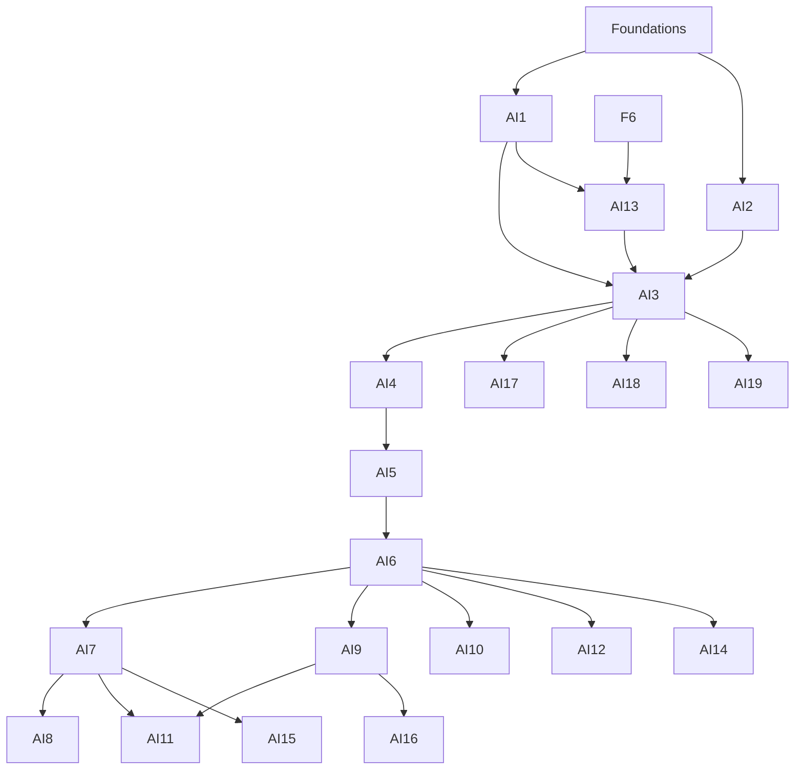

# Track 3 — AI & Machine Learning

This track treats ML as an engineering discipline: data quality, baselines, evaluation, error analysis, reproducibility, serving, safety, and cost. A model that cannot be evaluated is a demo, not a system.

**Entry:** Foundations (F0–F6). Python is the working language. F4 and F6 are especially important. A GPU is useful from AI4 onward but not required for the core path; every GPU lab has a CPU/simulator fallback with an explicit limitation.

## Courses

| Code | Course | Prerequisite | Weeks | Hours | Project | Status |
| --- | --- | --- | ---: | ---: | --- | --- |
| [AI1](AI1-python-for-data-and-ai.md) | Python for Data & AI | F1, F6 | 4 | 60 | P7 data audit | `draft` |
| [AI2](AI2-optimization-and-probabilistic-ml.md) | Optimization & Probabilistic ML | F4 | 4 | 60 | P7 math checks | `draft` |
| [AI3](AI3-classical-machine-learning.md) | Classical Machine Learning | AI1, AI2 | 6 | 90 | P7 signal-score | `draft` |
| [AI4](AI4-deep-learning-foundations.md) | Deep Learning Foundations | AI3 | 6 | 90 | P7 neural baseline | `draft` |
| [AI5](AI5-vision-and-sequence-architectures.md) | Vision & Sequence Architectures | AI4 | 5 | 75 | P8 architecture study | `draft` |
| [AI6](AI6-transformers-nlp-and-llms.md) | Transformers, NLP & LLMs | AI5 | 7 | 105 | P8 tinygpt | `draft` |
| [AI7](AI7-training-fine-tuning-and-alignment.md) | Training, Fine-Tuning & Alignment | AI6 | 5 | 75 | P8 LoRA comparison | `draft` |
| [AI8](AI8-distributed-and-large-scale-training.md) | Distributed & Large-Scale Training | AI7; S11 recommended | 5 | 75 | P8 scaling report | `draft` |
| [AI9](AI9-inference-serving-and-optimization.md) | Inference, Serving & Optimization | AI6; S9 recommended | 5 | 75 | P9 serving benchmark | `draft` |
| [AI10](AI10-retrieval-agents-and-applied-genai.md) | Retrieval, Agents & Applied GenAI | AI6 | 5 | 75 | P9 doc-compass | `draft` |
| [AI11](AI11-mlops-and-production-deployment.md) | MLOps & Production Deployment | AI7, AI9 | 5 | 75 | P9 deployment/rollback | `draft` |
| [AI12](AI12-responsible-ai-safety-and-governance.md) | Responsible AI, Safety & Governance | AI6 | 4 | 60 | P9 system card/risk register | `draft` |
| [AI13](AI13-data-engineering-for-ml.md) | Data Engineering for ML | F6, AI1 | 5 | 75 | P7 data pipeline | `draft` |
| [AI14](AI14-generative-and-multimodal-models.md) | Generative & Multimodal Models | AI6 | 5 | 75 | elective | `draft` |
| [AI15](AI15-reinforcement-learning-and-rlhf.md) | Reinforcement Learning & RLHF | AI7, F4 | 6 | 90 | elective | `draft` |
| [AI16](AI16-gpu-programming-and-kernels.md) | GPU Programming & Kernels | S13 or AI9 | 5 | 75 | elective | `draft` |
| [AI17](AI17-causal-inference-and-experimentation.md) | Causal Inference & Experimentation | AI3, F4 | 4 | 60 | elective | `draft` |
| [AI18](AI18-recommender-systems-and-ranking.md) | Recommender Systems & Ranking | AI3 | 4 | 60 | elective | `draft` |
| [AI19](AI19-time-series-and-forecasting.md) | Time Series & Forecasting | AI3, F4 | 4 | 60 | elective | `draft` |

Core AI1–AI13: **66 course-weeks, 990 hours**. Calendar at 15 h/week with buffer: ~2.5–3 years after Foundations.

## Dependency graph

AI13 is a data-engineering support course; it can run beside AI1–AI3. AI8 is only required for training-infrastructure roles. AI14–AI19 are electives.

## Specialisation profiles

| Profile | Courses | Portfolio |
| --- | --- | --- |
| Applied ML / data science | AI1–AI4, AI13, AI17 | P7 + one causal/experiment study |
| Deep learning / LLM engineer | AI3–AI10 | P8 + P9 |
| AI infrastructure | AI6, AI8, AI9, S9, S11, S13, S14 | P9 + P4 |
| AI product engineer | AI1–AI7, AI10–AI12 | P7 + P9 |
| MLOps / platform | AI3, AI7, AI9, AI11, AI13, S14, S15 | P9 + deployment/rollback evidence |
| Safety / evaluation | AI6, AI7, AI10, AI12, AI15 | P9 + system card + red-team report |

## Reading and resources

There is no single local AI book in `books/`. The core external spine is:

- *Mathematics for Machine Learning* (free) for AI2;
- *An Introduction to Statistical Learning* (free) for AI3;
- *Dive into Deep Learning* (free) and PyTorch tutorials for AI4–AI5;
- *The Annotated Transformer* / *nanoGPT* / the Transformer paper for AI6;
- Hugging Face PEFT/TRL docs for AI7;
- *Designing Machine Learning Systems* for AI11;
- current OWASP GenAI, NIST AI RMF, and EU AI Act guidance for AI12.

Exact chapters and alternatives are in [../resources.md](../resources.md).

## Evaluation standard

Every ML artifact must include:

- a dataset card with source, license, collection, limitations, and sensitive fields;
- a frozen train/validation/test split and a trivial baseline;
- a metric justified by the real error cost;
- error analysis, not just one aggregate score;
- seeds, versions, hardware, and a reproducible command;
- a model card with intended use, non-use, and failure cases;
- an explicit statement of what the evaluation cannot prove.

If a result cannot be reproduced from a clean checkout, it is not evidence.

## Exit standard

You can build, evaluate, deploy, monitor, and explain a model/system; identify leakage and contamination; diagnose a training or serving failure; and state the safety, privacy, and cost trade-offs without hand-waving.
