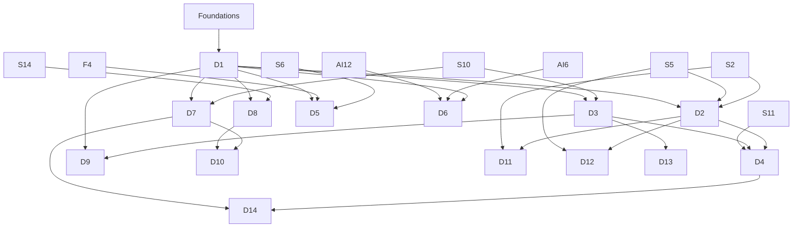

# Track 4 — Security Engineering

Security engineering is the discipline of designing, building, verifying, and operating systems that resist misuse. Offensive technique is one tool, not the whole job. Every practical activity in this track happens on a system you own or have **explicit written authorization** to test, inside an isolated lab.

**Entry:** Foundations (F0–F6), plus the systems prerequisites for the later courses. `D` is the security course prefix retained from the original curriculum.

## Authorization rule

Before any scanning, exploitation, or red-team work:

- define the scope, assets, time window, and prohibited actions in writing;
- use a local VM, container, or named training platform;
- snapshot the target and record a rollback path;
- never test public, third-party, employer, school, or client systems without a signed authorization;
- do not retain or publish weaponized payloads, real credentials, or personal data;
- stop immediately if an action could affect availability or data integrity.

D1 produces the rules of engagement used by every later course and project.

## Courses

| Code | Course | Prerequisite | Weeks | Hours | Project | Status |
| --- | --- | --- | ---: | ---: | --- | --- |
| [D1](D1-security-foundations-and-threat-modeling.md) | Security Foundations & Threat Modeling | Foundations | 4 | 60 | P10 rules of engagement | `draft` |
| [D2](D2-memory-corruption-and-binary-exploitation.md) | Memory Corruption & Binary Exploitation | S2, S5, D1 | 6 | 90 | P10 vulnerable/fixed pair | `draft` |
| [D3](D3-network-and-web-application-security.md) | Network & Web Application Security | S10, D1 | 6 | 90 | P10 secure-review | `draft` |
| [D4](D4-systems-and-infrastructure-penetration-testing.md) | Systems & Infrastructure Penetration Testing | D2, D3, S11 | 6 | 90 | P11 assessment | `draft` |
| [D5](D5-applied-cryptography-and-secure-systems-design.md) | Applied Cryptography & Secure Systems Design | D1, S6, F4 | 5 | 75 | P11 protocol review | `draft` |
| [D6](D6-ai-security-and-red-teaming.md) | AI Security & Red Teaming — elective for the AI-security profile | D1, AI6, AI12 | 4 | 60 | P11 AI red-team | `draft` |
| [D7](D7-detection-incident-response-and-forensics.md) | Detection, Incident Response & Forensics | D1, S10 | 5 | 75 | P11 detection/IR drill | `draft` |
| [D8](D8-cloud-container-and-kubernetes-security.md) | Cloud, Container & Kubernetes Security | D1, S14 | 5 | 75 | P11 cloud assessment | `draft` |
| [D9](D9-secure-sdlc-appsec-and-supply-chain.md) | Secure SDLC, AppSec & Supply Chain | D1, D3 | 4 | 60 | P10 secure SDLC review | `draft` |
| [D10](D10-privacy-compliance-and-governance.md) | Privacy, Compliance & Governance | D1, D7, D8 | 4 | 60 | P11 risk register | `draft` |
| [D11](D11-reverse-engineering-and-malware-analysis.md) | Reverse Engineering & Malware Analysis | D2, S2 | 5 | 75 | elective | `draft` |
| [D12](D12-hardware-embedded-and-iot-security.md) | Hardware, Embedded & IoT Security | D2, S5 | 5 | 75 | elective | `draft` |
| [D13](D13-mobile-application-security.md) | Mobile Application Security | D3 | 4 | 60 | elective | `draft` |
| [D14](D14-red-team-operations-and-adversary-emulation.md) | Red Team Operations & Adversary Emulation | D4, D7 | 5 | 75 | elective | `draft` |

Core D1–D5 and D7–D10: **45 course-weeks, 675 hours**. D6 is an AI-security elective and assumes AI1–AI6 plus AI12; it is not counted in the core path. With the required systems prerequisites (S1, S2, S5, S6, S10, S11, S14; 42 weeks, 630 hours), the full Security path is **2,205 hours**, or about 3.4 years at 15 h/week with buffer.

## Dependency graph

D1 can start immediately after Foundations. D2 waits for S2/S5. D3 waits for S10. D4 waits for D2, D3, and S11. D8 requires S14, so complete it before the cloud-security block. D6 is a cross-track elective: take it only after AI6 and AI12, or defer it until the AI track reaches those courses.

## Specialisation profiles

| Profile | Courses | Portfolio |
| --- | --- | --- |
| Application security | D1, D3, D5, D9 + S10 | P10 secure-review + P11 web assessment |
| Cloud / platform security | D1, D3, D7, D8, D9, D10 + S14 | P11 cloud assessment |
| Detection / incident response | D1, D3, D7, D10 + S10/S15 | P11 detection/IR drill |
| Offensive security | D1–D4, D7, D14 | P11 authorized assessment |
| AI security | D1, D6, D9 + AI1–AI6/AI10/AI12 | P11 AI red-team |
| Cryptography / product security | D1, D5, D9 + S6/F4 | P11 protocol review |

## Reading

Local books provide the systems and OS foundation (B2, B4, B5). Security-specific books are external: *Threat Modeling: Designing for Security*, *Serious Cryptography* 2nd ed., *The Web Application Hacker's Handbook*, OWASP ASVS/Top 10, PortSwigger Academy, pwn.college, MITRE ATT&CK, and cloud/Kubernetes security references. Exact sources are in [../resources.md](../resources.md).

## Exit standard

You can:

- define scope and trust boundaries;
- turn a threat into a security requirement and a test;
- find and explain a vulnerability without publishing a weaponized payload;
- verify a fix and write a regression test;
- distinguish a vulnerability from a misconfiguration and from an accepted risk;
- produce a developer-actionable report with severity rationale and residual risk;
- operate detection, response, and recovery for the systems you build.
