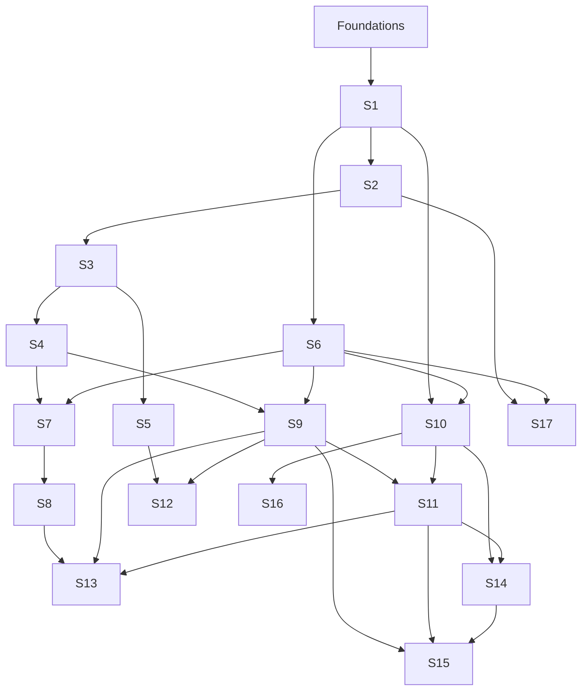

# Track 2 — Systems Engineering

Systems engineering is the study of what the machine actually does: instructions, memory, caches, processes, files, networks, concurrency, storage, distributed systems, and the operational discipline that keeps them alive.

Use **C** for labs that expose raw OS/machine behaviour. Use **Rust** for systems you intend to keep. Do not hide a mechanism behind a framework.

**Entry:** Foundations (F0–F6), especially F3 and F5. Linux is required from S1. A VM, bare-metal install, or development container is acceptable; macOS alone is not a substitute for the Linux-specific labs.

## Courses

| Code | Course | Prerequisite | Weeks | Hours | Project | Status |
| --- | --- | --- | ---: | ---: | --- | --- |
| [S1](S1-computer-systems-foundations.md) | Computer Systems Foundations | F3, F5 | 6 | 90 | P2 sysprobe | `draft` |
| [S2](S2-machine-code-cpu-and-architecture.md) | Machine Code, CPU & Architecture | S1 | 6 | 90 | P2 disassembly report | `draft` |
| [S3](S3-memory-hierarchy-and-locality.md) | Memory Hierarchy & Locality | S2 | 4 | 60 | P3 memory mountain | `draft` |
| [S4](S4-cpu-caches.md) | CPU Caches | S3 | 4 | 60 | P3 cache simulator | `draft` |
| [S5](S5-virtual-memory.md) | Virtual Memory | S3 | 5 | 75 | P2 mmap/page-fault lab | `draft` |
| [S6](S6-concurrency-atomics-and-memory-models.md) | Concurrency, Atomics & Memory Models | S1, F5 | 6 | 90 | P4 bounded queue/thread pool | `draft` |
| [S7](S7-cache-coherence-and-false-sharing.md) | Cache Coherence & False Sharing | S4, S6 | 2 | 30 | P3 false-sharing study | `draft` |
| [S8](S8-numa-and-memory-topology.md) | NUMA & Memory Topology | S7 | 2 | 30 | P3 topology report | `draft` |
| [S9](S9-performance-engineering-and-observability.md) | Performance Engineering & Observability | S4, S6 | 5 | 75 | P3/P4 perf investigations | `draft` |
| [S10](S10-linux-systems-programming-and-networking.md) | Linux Systems Programming & Networking | S1, S6 | 7 | 105 | P4 workbenchd | `draft` |
| [S11](S11-distributed-systems.md) | Distributed Systems | S9, S10 | 7 | 105 | P6 raftkv | `draft` |
| [S12](S12-data-systems-and-storage-engines.md) | Data Systems & Storage Engines | S5, S9 | 6 | 90 | P5 minikv | `draft` |
| [S13](S13-ai-infrastructure-systems-lens.md) | AI Infrastructure (Systems Lens) | S8, S9, S11 | 5 | 75 | P9 serving/gateway | `draft` |
| [S14](S14-containers-virtualization-and-cloud-operations.md) | Containers, Virtualization & Cloud Operations | S10, S11 | 5 | 75 | P4 deployment | `draft` |
| [S15](S15-reliability-incident-response-and-sre.md) | Reliability, Incident Response & SRE | S9, S11, S14 | 4 | 60 | P4 SLO/incident drill | `draft` |
| [S16](S16-networking-and-protocols-deep-dive.md) | Networking & Protocols Deep Dive | S10 | 4 | 60 | elective | `draft` |
| [S17](S17-compilers-and-language-runtimes.md) | Compilers & Language Runtimes | S2, S6 | 6 | 90 | elective | `draft` |

Core S1–S15: **74 course-weeks, 1,110 hours**. Calendar at 15 h/week with buffer: ~2–2.5 years after Foundations.

## Dependency graph

Solid lines are prerequisites. You may run independent branches in parallel, but keep the critical path `S1 → S2 → S3 → S4 → S6 → S9 → S10 → S11 → S12 → capstone`.

## Specialisation profiles

Choose one profile after S5. The others become supporting skills.

| Profile | Courses after S5 | Portfolio |
| --- | --- | --- |
| Backend / infrastructure | S6, S9, S10, S14, S15 | P4 + P5 |
| Performance engineering | S4, S6, S7, S8, S9, S13 | P3 + P4 |
| Storage / distributed systems | S6, S9, S10, S11, S12 | P5 + P6 |
| AI infrastructure | S9, S10, S11, S13, S14, S15 | P4 + P9 |
| Security foundations | S6, S10, S11, S14 | P4 + P5 |

## Reading

Local books: B1, B2, B3, B4, B5, B6. External core: *Computer Systems: A Programmer's Perspective* (CS:APP), *Rust Atomics and Locks*, *Designing Data-Intensive Applications*, *Database Internals*, and official Linux/performance documentation. Exact sections are in each course file and [../books/](../books/README.md).

## Exit standard

You are a systems engineer, not a course collector, when you can:

- explain a program from source to syscall to CPU to memory;
- diagnose a performance problem with evidence;
- write correct concurrent code and defend its memory ordering;
- build a network service that handles partial I/O, overload, and shutdown;
- prove what survives a crash or a network partition;
- operate what you built with metrics, SLOs, and a rollback plan.
